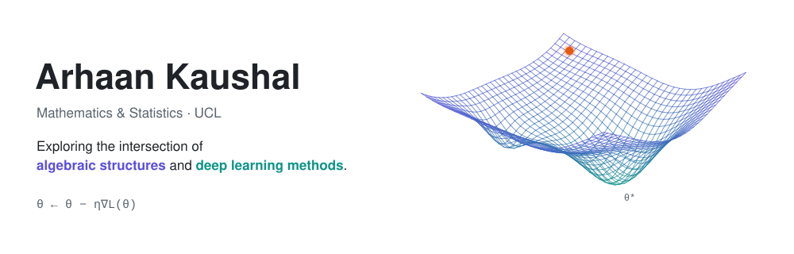

  <picture>
    <source media="(prefers-color-scheme: dark)" srcset="assets/surface-dark.svg">
    
  </picture>

Hey, I am Arhaan. I enjoy maths, and in particular looking at the maths underlying modern AI. Currently I am curious to see how algebraic structure can play a role. I am open to learning and trying new things :)

  

  
  
  
  
  
  
  

